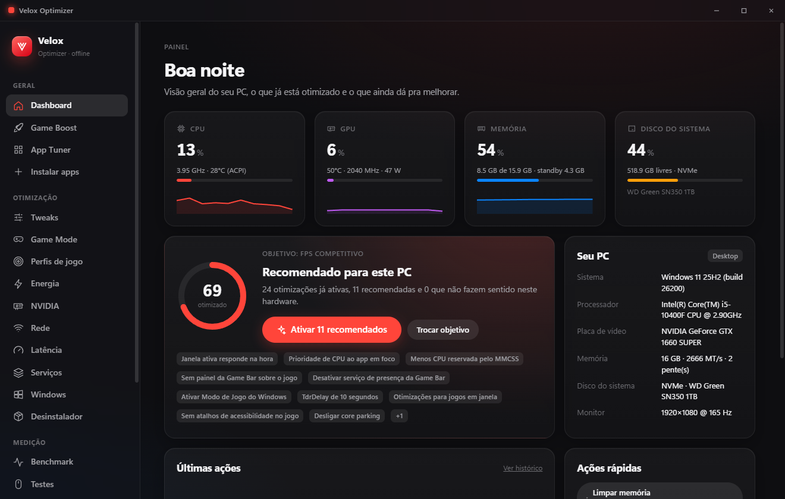
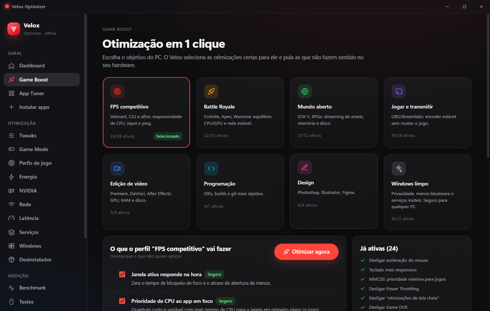
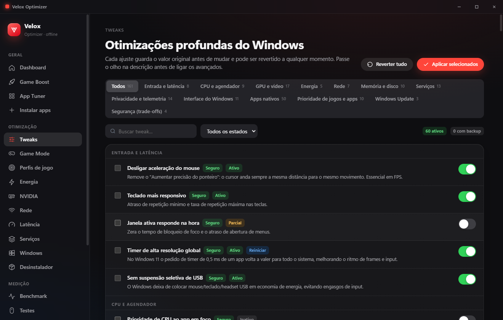
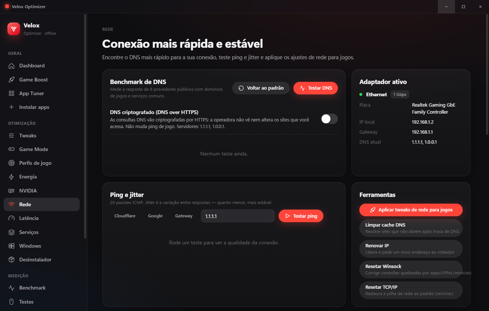
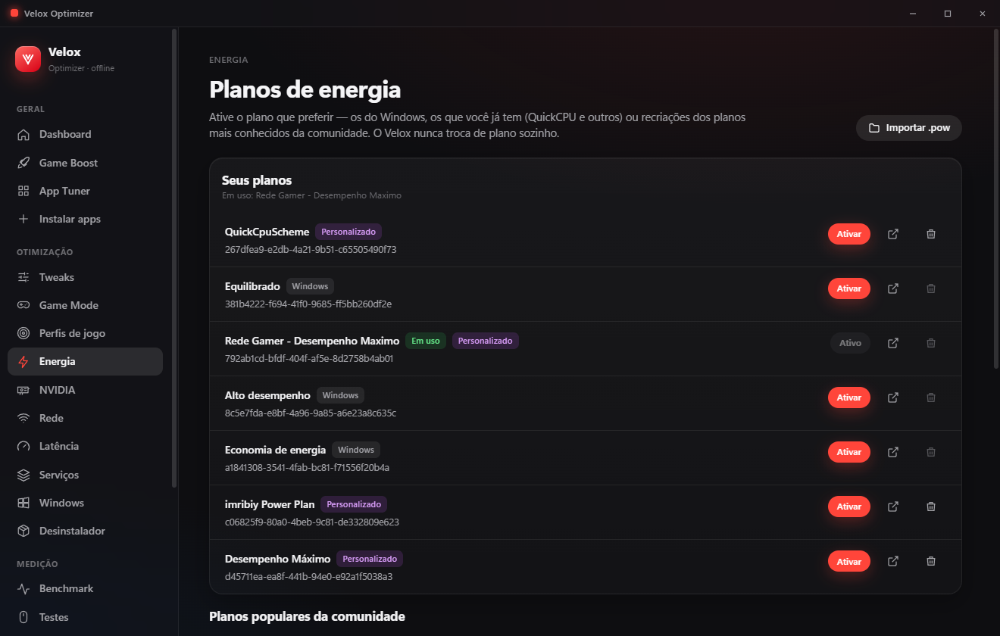

<div align="center">


# Velox Optimizer

**Otimizador de Windows para jogos — 100% offline, sem conta, sem anúncios e reversível.**




</div>

---

## Por que o Velox

- **Tudo é reversível.** Antes de mudar qualquer coisa, o valor original é salvo. Desfaça um item, uma ação do histórico ou tudo de uma vez.
- **Decide pelo seu hardware.** Notebook na bateria, HDD x SSD, quantidade de RAM, núcleos, GPU NVIDIA/AMD, Windows 10/11 — o que não faz sentido no seu PC é bloqueado com o motivo.
- **Mede em vez de prometer.** Benchmark de antes/depois com FPS, 1% low, frametime, ping e precisão do timer.
- **Protege contra o pior.** Proteção de boot, vigia de vídeo, ponto de restauração e detecção de Restauração do Sistema.
- **Leve.** Na bandeja usa ~3 processos e ~0,05% de CPU; nada consulta a GPU enquanto você joga.

## Recursos

| Área | O que faz |
|---|---|
| **Dashboard** | CPU, GPU, RAM e disco ao vivo, clock real, temperaturas, throttling, recomendações e relatório do PC em HTML |
| **Game Boost** | 8 objetivos (FPS competitivo, Battle Royale, mundo aberto, stream, edição, programação, design, Windows limpo) |
| **Tweaks** | 160+ ajustes em 13 categorias com nível de risco, regras por hardware e reversão individual |
| **Game Mode** | Detecta o jogo, aplica ajustes temporários (prioridade, notificações, timer, serviços, afinidade P-core) e desfaz ao fechar |
| **Perfis de jogo** | Regras por executável: prioridade de CPU e disco, núcleos, GPU dedicada, tela cheia exclusiva |
| **Energia** | Seus planos + recriações dos planos populares da comunidade, importação/exportação `.pow` |
| **NVIDIA** | Configurações 3D globais do driver via NVAPI (os mesmos itens do Painel de Controle) com backup |
| **Rede** | Benchmark de DNS, DNS criptografado (DoH), ping/jitter contínuo, Adapter Tuner, pilha TCP e prioridade QoS |
| **Latência** | Timer personalizado com medição real do `Sleep(1)`, limpeza de memória standby e MSI/afinidade por dispositivo |
| **Serviços** | 59 serviços com explicação, quando manter e o que **não** desligar |
| **Windows** | Limpeza, inicialização, apps nativos, reparos (SFC/DISM/Windows Update) e pontos de restauração |
| **Desinstalador** | Programas e apps da Store com busca de sobras em pastas, atalhos e registro |
| **App Tuner** | Discord, navegadores, Steam, Epic, EA, Ubisoft, Battle.net, Spotify, WhatsApp, OBS, Adobe CC |
| **Benchmark e Testes** | FPS com PresentMon, polling do mouse, clique duplo e taxa do monitor |
| **Mais** | Biblioteca de jogos (Steam, Epic, Riot…), instalação em lote via winget, automações, modo portátil, exportar/importar setup |

<details>
<summary><b>Mais capturas de tela</b></summary>

| | |
|---|---|
|  |  |
|  |  |
|  |  |

</details>

## Instalação

Baixe a versão mais recente em **[Releases](../../releases/latest)**:

- `Velox Optimizer Setup x.y.z.exe` — instalador
- `Velox Optimizer x.y.z (portatil).exe` — não instala nada; guarda os dados numa pasta `Velox-Data` ao lado do executável

O app pede permissão de administrador (necessária para alterar configurações do sistema).

> **Aviso do SmartScreen:** o executável ainda não tem assinatura digital paga, então o Windows pode mostrar "Editor desconhecido". Clique em **Mais informações → Executar assim mesmo**. O código-fonte completo está aqui para conferência.

## Segurança

O Velox mexe no sistema, então foi construído para errar do lado seguro:

- **Backup antes de tudo** — cada tweak, serviço, dispositivo, perfil e configuração NVIDIA guarda o valor anterior.
- **Desfazer pelo histórico** — cada ação registrada pode ser desfeita individualmente.
- **Proteção de boot** — após ajustes que exigem reinício, se o Windows não chegar à área de trabalho 2 vezes seguidas, tudo é revertido automaticamente e o PC reinicia **uma única vez** (sem loop, sem modo de segurança).
- **Vigia de vídeo** — se o driver de vídeo travar ou reiniciar, o Velox avisa e oferece reverter os ajustes de vídeo recentes.
- **Restauração do Sistema detectada** — os registros antigos são arquivados e nada é reaplicado sozinho.
- **Itens arriscados marcados** — VBS/HVCI, mitigações de CPU, C-states, controladoras USB etc. pedem confirmação e explicam o custo.

> Mesmo assim: **crie um ponto de restauração** antes de aplicar em lote e aplique aos poucos, medindo com o Benchmark. Use por sua conta e risco.

## Compilar a partir do código

Requisitos: Windows 10/11, [Node.js](https://nodejs.org) 20+.

```bash
git clone https://github.com/tfmoramora74-ship-it/velox-optimizer.git
cd velox-optimizer
npm install
npm start          # rode o terminal como administrador
npm run dist       # gera o instalador e a versão portátil em dist/
```

Variáveis úteis no desenvolvimento:

| Variável | Efeito |
|---|---|
| `VELOX_SAFE=1` | Modo seguro: nenhuma ação automática no sistema (Game Mode, perfis, automações) |
| `VELOX_USERDATA=<pasta>` | Usa outra pasta de dados (não conflita com o Velox instalado) |

`node tools/screenshots.mjs` regenera as capturas de `docs/screenshots` em modo seguro.

## Arquitetura

```
src/
├─ main/                 processo principal (Node.js)
│  ├─ ps.js              pool de PowerShell persistente (reaproveitado, encerra quando ocioso)
│  ├─ reg.js             leitura/escrita de registro em lote (.NET, visão 64 bits)
│  ├─ tweaks/            catálogo, motor de aplicar/reverter/status, tweaks com lógica própria
│  ├─ gamemode.js        sessão de jogo + relatório
│  ├─ procwatch.js       vigia de processos compartilhado
│  ├─ memory.js          monitor sob demanda, standby, timer, sensores
│  ├─ safety.js          vigia de vídeo e detecção de Restauração do Sistema
│  ├─ bootguard.js       proteção contra boot quebrado
│  ├─ nvidia.js          NVAPI (perfil base do driver)
│  └─ …                  rede, energia, serviços, dispositivos, desinstalador, App Tuner, winget…
└─ renderer/             interface (HTML/CSS/JS puro, sem framework)
```

## Créditos

- IDs das configurações NVIDIA: cabeçalho público [NVIDIA/nvapi](https://github.com/NVIDIA/nvapi).
- Medição de FPS: [PresentMon](https://github.com/GameTechDev/PresentMon) (Intel), fornecido pelo usuário.
- Referências de ajustes: guias públicos da comunidade de baixa latência e documentação da Microsoft. Cada item foi conferido; os sem efeito comprovado ficaram de fora.

## Licença

[MIT](LICENSE). Velox Optimizer não é afiliado à Microsoft, NVIDIA, AMD, Intel nem a nenhum outro otimizador.
